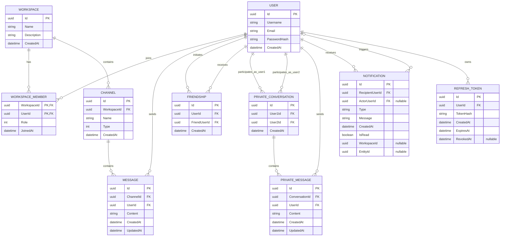

# ChatApp

## Features

### Authentication and user profiles
- User registration and login.
- JWT-based authentication with token refresh support.
- User profiles and user discovery.

### Workspaces and channels
- Create and manage workspaces for different teams or projects.
- Organize conversations into channels.
- Manage workspace membership and roles.
- Send and receive messages in real time.

### Private messaging and friendships
- Find users and manage friend connections.
- Start private conversations with friends.
- View conversation history.
- Preserve existing conversation history when a friendship ends.

### Real-time functionality
- Live message delivery using SignalR.
- Online presence tracking.
- Typing indicators.
- Real-time updates for supported application events.

### Notifications
- Receive notifications about relevant events within the application.

## Tech Stack

### Backend
- **C# / ASP.NET Core Web API (.NET 10)** — API endpoints and application entry point.
- **Entity Framework Core** — database access and schema migrations.
- **PostgreSQL** — relational data storage.
- **SignalR** — real-time messaging, presence, and typing events.
- **JWT** — authentication.
- **FluentValidation** — request validation.

### Frontend
- **React** — user interface.
- **TypeScript** — type-safe application code.
- **Vite** — frontend development server and build tooling.
- **React Router** — client-side routing.
- **TanStack Query** — server-state management and API data fetching.
- **Microsoft SignalR client** — real-time communication with the backend.

## Architecture

The backend is organized into separate projects to keep responsibilities distinct:

- **ChatApp.Api** — HTTP API, middleware, authentication configuration, and application startup.
- **ChatApp.Application** — application services, interfaces, and validation.
- **ChatApp.Domain** — core domain entities and business concepts.
- **ChatApp.Contracts** — request, response, and shared data-transfer contracts.
- **ChatApp.Infrastructure** — persistence, Entity Framework Core, and service implementations.
- **ChatApp.RealTime** — SignalR hubs and real-time infrastructure.
- **ChatApp.UnitTests** — unit tests for selected application services and components.

The frontend is maintained separately in the `frontend` directory.

## Database Schema

The application uses PostgreSQL with Entity Framework Core. The database is organized around users, workspaces, channels, and messaging, with additional tables for friendships, private conversations, notifications, and authentication.



**Key relationships:**

- A user can belong to multiple workspaces, and a workspace can have multiple members. Membership roles are stored in `WorkspaceMember`.
- Each workspace contains channels, and each channel contains messages.
- Friendships and private conversations connect two users independently of workspace membership.
- Private messages belong to a conversation and are associated with their sender.
- Notifications belong to a recipient and can optionally reference an actor and related application context.
- Refresh tokens belong to users and are stored as hashes.

## Repository Structure

```text
ChatApp/
├── backend/
│   ├── src/
│   │   ├── ChatApp.Api/
│   │   ├── ChatApp.Application/
│   │   ├── ChatApp.Contracts/
│   │   ├── ChatApp.Domain/
│   │   ├── ChatApp.Infrastructure/
│   │   ├── ChatApp.RealTime/
│   │   └── ChatApp.UnitTests/
│   ├── tools/
│   │   └── ChatApp.SignalRTester/
│   └── ChatApp.sln
├── frontend/
│   └── src/
└── README.md
```

## Getting Started

### Prerequisites

- .NET 10 SDK
- Node.js and npm
- PostgreSQL

### 1. Clone the repository

```bash
git clone https://github.com/TitovYehor/ChatApp.git
cd ChatApp
```

### 2. Configure the backend

Configure the following settings in the backend configuration or through .NET user secrets/environment variables:

- `ConnectionStrings:DefaultConnection` — PostgreSQL connection string.
- `JwtSettings:SecretKey` — secret key used to sign JWTs.
- `JwtSettings:Issuer` — token issuer.
- `JwtSettings:Audience` — token audience.

Use your own local development values. Do not commit real credentials or production secrets.

The application initializes the database and applies available Entity Framework Core migrations during startup. Make sure PostgreSQL is running and the configured database is accessible.

### 3. Run the backend

From the repository root:

```bash
dotnet run --project backend/src/ChatApp.Api
```

The API's local URL depends on the selected launch profile. Check `backend/src/ChatApp.Api/Properties/launchSettings.json` for the configured address.

### 4. Configure and run the frontend

Create a `.env.local` file in the `frontend` directory:

```env
VITE_API_BASE_URL=https://localhost:7163/api
VITE_SIGNALR_HUB_URL=https://localhost:7163/hubs/chat
```

Adjust these values if your backend uses a different local URL.

Then run:

```bash
cd frontend
npm install
npm run dev
```

Vite will print the local frontend URL in the terminal.

### 5. Build and test

Build the frontend:

```bash
cd frontend
npm run build
```

Run the backend unit tests:

```bash
dotnet test backend/ChatApp.sln
```

## Project Goals

ChatApp demonstrates practical experience with:

- Building a full-stack application with React, TypeScript, and ASP.NET Core.
- Separating backend responsibilities into dedicated projects.
- Designing relational data models and managing schema changes with EF Core.
- Implementing authentication and authorization.
- Building real-time features with SignalR.
- Managing asynchronous API state in a frontend application.
- Writing unit tests for backend services.
